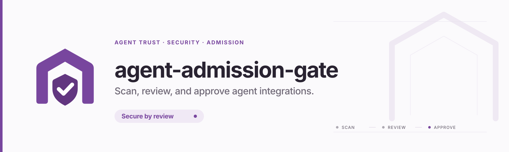

<picture>
  <source media="(prefers-color-scheme: dark)" srcset="assets/brand/original/readme-banner-dark.svg">
  
</picture>

# Agent Admission Gate

**에이전트 도구와 Skill을 반입하기 전에, 위험 근거를 확인하고 판정·검토 이력을 남기는 서비스.**

FastAPI + React 기반의 독립 구현입니다. Cisco 제품이 아니며, 사내 소스·주소·인증정보를 포함하지 않습니다. Git 저장소 또는 ZIP 패키지를 접수하고 정적 검사, SBOM, 취약점·라이선스 검사, 선택한 모델의 보조 판단을 동일한 정책으로 통합합니다.

## 실행

Python 3.12+, Node.js 24, uv, Git이 필요합니다.

```bash
cp .env.example .env
# .env의 AAG_BOOTSTRAP_PASSWORD를 12자 이상의 비밀번호로 설정
uv sync --frozen
cd frontend && npm ci && npm run build && cd ..
uv run uvicorn aag.main:app --host 127.0.0.1 --port 8000 --no-access-log
```

<http://localhost:8000>에서 `admin`과 설정한 비밀번호로 로그인합니다. 기존 계정의 비밀번호는 재시작으로 변경되지 않습니다. 다른 로컬 사용자는 `uv run aag create-local-user USERNAME`으로 생성합니다. SSO 운영 환경은 [배포 가이드](docs/src/content/docs/operations/deployment.md)를 따릅니다.

Docker Compose에는 PostgreSQL 18.1이 포함됩니다. 아래 두 환경변수를 직접 설정한 후 실행하세요. 개발용 Compose만 스키마를 자동 생성합니다.

```bash
export AAG_BOOTSTRAP_PASSWORD='replace-with-your-strong-password'
export POSTGRES_PASSWORD='replace-with-a-different-strong-password'
docker compose up --build
```

## 구현 범위

- **검사:** Git/ZIP, static/full, 비동기 접수와 최대 30초 동기 대기, 동시 실행 제한, 취소, 소스 SHA256 기반 캐시, 강제 재검사, JSON/SARIF 내보내기.
- **판정:** ALLOW/REVIEW/BLOCK, 원래 판정과 최종 판정 분리, 엔진 누락·실패 시 검토 필요, 동작 범주와 발견 위치·개선 방법.
- **검토·권한:** user/admin 역할과 독립적인 reviewer 자격, 본인 승인 차단, 사유 필수, 내부 코멘트, 감사 로그, 소스 해시·만료일에 묶인 예외.
- **인증·연동:** Keycloak 호환 OIDC + PKCE, HttpOnly 세션, 1회 노출 API 키, 개인/관리자 키 관리, 8자리·10분 Device Code Flow, 90일 키, REST·CLI·Remote MCP.
- **운영 화면:** 역할별 대시보드, Recharts 차트, 7/14/30/90일, 작업 목록/검색, 상세 8개 탭, 관리자 운영·사용자·전체 키·감사·예외·Action·LLM 화면.
- **사용량:** 실제 REST/MCP 호출, 제공자·모델별 토큰, 캐시 토큰, 지연·실패, CSV. On-prem/Bedrock/SystemOne 구분; 미보고 토큰·비용은 null.
- **공지·VOC:** 공지/내부 검토/VOC, Markdown·미리보기, 비공개 글, 내부 코멘트, 상태·고정·읽음·수정 충돌 방지. 기본 비노출: `AAG_BOARDS_ENABLED=false`이면 메뉴와 API 모두 차단.
- **브랜드:** 기존 Gate/Shield/Check 로고 형태 유지, CSS 브랜드 토큰, 다크/라이트·Plum/Teal/Blue, 런타임 파비콘, Pretendard Variable·D2Coding, 항상 어두운 코드 블록.

[전체 요구사항 추적표](docs/src/content/docs/operations/requirements.md) · [보안 경계](SECURITY.md) · [디자인 계약](DESIGN.md)

## 엔진과 외부 연결

| 프로필 / 엔진 | 실제 동작 | 필요한 외부 구성 |
| --- | --- | --- |
| static / builtin | 소스 규칙과 동작 범주 검사 | 없음 |
| static / Cisco Skill | 발견한 `SKILL.md` 디렉터리 검사 | `skill-scanner` |
| static / Cisco MCP | 발견한 `tools.json` 메타데이터 검사 | `mcp-scanner` |
| full / Syft → Grype + Grant | SBOM·CVE·라이선스, 패키지 수 대조 | 각 CLI와 최신 Grype DB |
| full / OSV (선택) | 소스·잠금파일 취약점 검사 | `AAG_OSV_ENABLED=true`, `osv-scanner` |
| full / 모델 | 정적 근거의 보조 검토 | 온프렘 OpenAI 호환 API, Bedrock Converse 또는 SystemOne |

**`runtime` 빌드 타깃과 기본 Compose는 Git과 내장 검사기만 포함합니다.** 전체 엔진 이미지는 `docker build --target scanners -t aag:scanners .`로 빌드합니다. 설치되지 않은 필수 엔진이나 미설정 모델을 정상 통과로 취급하지 않습니다. 정적 ALLOW는 악성 행위가 없다는 보장이 아닙니다. 업로드 코드를 실행하거나 임의 MCP 서버에 접속하는 기능은 제공하지 않습니다.

외부 SSO·실제 Bedrock/온프렘 모델·검사기 바이너리·Kubernetes 클러스터와의 현장 통합 검증은 배포자가 수행해야 합니다. 이 저장소의 자동 검증은 API/권한/상태 전이/어댑터 계약/브라우저 동작을 확인하며, 운영 성능·침투 테스트를 대체하지 않습니다.

## 개발과 검증

```bash
make check                  # Python lint/format, TypeScript/build, theme contrast
uv run pytest               # API, authorization, policy, input boundaries, adapters
cd frontend
npx playwright install chromium
npm run test:e2e             # 실제 서버 + 브라우저 흐름
cd ../docs && npm ci && npm run build  # Astro Starlight
```

한 프로세스/한 replica로 시작합니다. 업로드·클론 데이터와 일시 인증정보는 임시 작업 공간/메모리에서만 사용하며 재시작 시 미완료 작업은 FAILED로 복구합니다. 다중 replica, durable queue, 객체 저장소 및 대규모 집계로의 전환은 [확장 계획](docs/src/content/docs/operations/deployment.md#확장-계획)에 명시되어 있습니다.

자체 코드의 배포 라이선스는 아직 지정하지 않았습니다. 의존성·폰트·외부 엔진의 라이선스는 [THIRD_PARTY_NOTICES.md](THIRD_PARTY_NOTICES.md)를 확인하세요.
