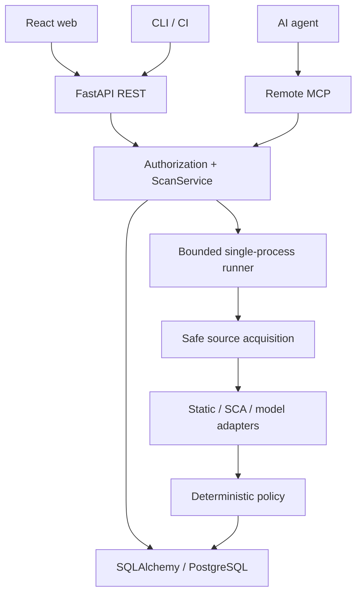

## 현재 구조

인증/권한과 판정 정책은 모델에 맡기지 않습니다. 모델 입력은 정규화된 위험 근거와 파일 수로 제한합니다. 모델은 REVIEW 신호를 추가할 수 있지만 정적 BLOCK을 해제하지 않습니다.

프로세스 내부 task/semaphore와 PostgreSQL 영속 작업 메타데이터를 조합합니다. API와 Runner는 코드 책임이 분리되어 있지만, 복잡한 분산 큐를 먼저 도입하지 않습니다. 임시 소스/credential이 없어진 작업은 재시작 시 명시적으로 실패 처리합니다.

## 데이터

User, Session, APIKey, DeviceClient/Grant, OIDCState, Job, Review, Comment, Post/Read, ExceptionRule, Audit, Usage 테이블을 제공합니다. PostgreSQL은 운영용이며 SQLite는 로컬 검증용입니다. Alembic 초기 migration을 포함하고 운영은 schema auto-create 대신 사전 migration을 요구합니다.

원본 저장소 전체나 업로드 파일은 영구 보관하지 않습니다. normalized findings, 실행 결과, 소스 hash/commit, SBOM 패키지 요약, 모델의 typed 판단/사용량, 검토/감사 이력만 저장합니다. Raw JSON 탭은 이 API 결과의 원문으로, 비밀정보를 포함할 수 있는 scanner stdout 전체 덤프가 아닙니다.

## LLM provider

- `onprem`: 지정한 OpenAI 호환 `/chat/completions`. LiteLLM/vLLM 등 endpoint를 구성합니다.
- `bedrock`: AWS SDK의 Converse. 표준 credential chain/워크로드 역할을 사용합니다. 키를 UI나 DB에 저장하지 않습니다.
- `systemone`: native `/v1/systemone`, `model/state/questions`, `noul` 원확률과 answers를 보존합니다. 도메인 정책에서 threshold를 적용하며 boolean으로 섣불리 변환하지 않습니다. hosted/ollama runtime을 명시합니다.

이 버전의 SystemOne 업무 질문은 `needs_review` noul 하나입니다. choice/score를 일반 채팅 요청으로 흉내내지 않습니다. 분류/점수 업무가 추가되면 provider capability와 응답 계약을 별도로 확장해야 합니다. 선택된 provider 실패 시 다른 외부 제공자로 데이터를 자동 전송하지 않고 REVIEW로 돌아갑니다.
